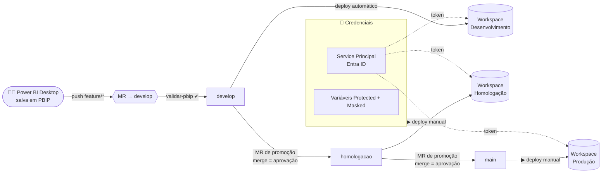

<div align="center">

# 🚦 Esteira CI/CD para Power BI

**Versionamento em PBIP e promoção Desenvolvimento → Homologação → Produção com aprovação, validação automática e deploy pela API do Fabric**

[](https://github.com/gilbertosales/powerbi-cicd-esteira/actions/workflows/ci.yml)


</div>

> Versão pública e anonimizada de uma esteira que implantei num **órgão público** para os painéis de BI da área de TI. IDs, domínios, nomes de servidores e relatórios reais foram removidos. O relatório em `relatorios/` é um exemplo sintético.

---

## 🎯 O problema

Os relatórios eram publicados direto do Power BI Desktop para produção. Não havia histórico do que mudou, revisão nem caminho de volta. A **integração Git nativa do Fabric** aceita só Azure DevOps e GitHub, e o repositório corporativo era **GitLab self-hosted (Community Edition)**, sem os recursos de aprovação das edições pagas.

## ✅ A solução

O GitLab passa a ser a fonte da verdade e o pipeline publica nos workspaces pela **API oficial do Fabric**, usando `fabric-cicd` e um Service Principal.



### Aprovação sem recursos pagos

| Controle | Efeito |
|---|---|
| `develop`, `homologacao` e `main` com **push: ninguém** | Toda mudança entra por Merge Request |
| **Merge só por Maintainers** | Só os aprovadores promovem entre ambientes |
| Deploy de homologação e produção **manual** | O aprovador escolhe o momento da publicação |
| Variáveis **Protected** | O segredo do Service Principal só existe em pipelines de branches protegidas |
| MR exige **pipeline verde** e **discussões resolvidas** | Nada quebrado é promovido |
| `resource_group` por ambiente | Nunca há dois deploys simultâneos no mesmo workspace |

## 🧩 O que tem aqui

```text
├── .gitlab-ci.yml                 # esteira original (GitLab, runner Windows)
├── .github/workflows/ci.yml       # a mesma esteira portada para GitHub Actions + Environments
├── .gitlab/merge_request_templates/Promocao.md
├── config/ambientes.json          # workspace de cada ambiente (IDs fictícios)
├── scripts/
│   ├── validar_pbip.py            # valida estrutura PBIP/PBIR/TMDL, JSON e arquivos proibidos
│   ├── deploy.py                  # dry-run ou publicação real com fabric-cicd
│   └── testar_conexao.py          # diagnóstico do Service Principal (somente leitura)
├── relatorios/Vendas_Exemplo.*    # relatório sintético em PBIP (TMDL + PBIR)
├── tests/                         # pytest da validação e do deploy
└── docs/esteira.md                # guia de operação, rollback e troubleshooting
```

### Validação (`validar_pbip.py`)
- cada `.Report` tem `definition.pbir` e o modelo referenciado existe
- cada `.SemanticModel` tem `definition.pbism` e a definição em TMDL ou `model.bim`
- todo `.json`, `.pbir`, `.pbism`, `.platform` e `.pbip` é JSON válido em UTF-8
- `.pbix`, `cache.abf` e `localSettings.json` nunca entram no repositório (dados e configurações locais)

### Deploy (`deploy.py`)
- **dry-run** (padrão): lista o que seria publicado, sem chamar a API. Foi assim que a esteira entrou em produção, antes de existir o Service Principal
- **real**: `fabric-cicd` publica modelos semânticos e relatórios no workspace do ambiente

### Diagnóstico (`testar_conexao.py`)
Obtém o token no Entra ID e lista os itens de cada workspace, traduzindo os erros mais comuns (`AADSTS7000215`, `InsufficientPrivileges`, `WorkspaceNotFound`...) em instruções do que corrigir.

## 📊 Resultados

- **3 ambientes** com deploy real pela esteira e trilha de auditoria completa em MRs e pipelines
- **Rollback testado:** um *revert* na `develop` foi promovido até produção pela própria esteira, restaurando a versão anterior nos três workspaces
- Documentação operacional completa, com tutorial do fluxo diário, configuração do Service Principal, runner e troubleshooting
- Lição aprendida que virou regra: depois de um *revert* feito pela interface entrar direto na `develop`, ela também passou a aceitar só MR

## 🚀 Testar localmente

```bash
python scripts/validar_pbip.py relatorios
python scripts/deploy.py --ambiente desenvolvimento --modo dry-run
pip install pytest && pytest -q
```

Para usar de verdade: crie um App Registration no Entra ID, adicione o Service Principal como **Membro** dos workspaces, libere *Service principals can use Fabric APIs* no portal de administração e configure `AZURE_TENANT_ID`, `AZURE_CLIENT_ID` e `AZURE_CLIENT_SECRET` como variáveis protegidas. Detalhes em [`docs/esteira.md`](docs/esteira.md).

---

<div align="center">
Feito por <a href="https://github.com/gilbertosales">Gilberto Sales</a> · <a href="https://www.linkedin.com/in/gilberto-gomes-de-sales-3a979651">LinkedIn</a>
</div>
